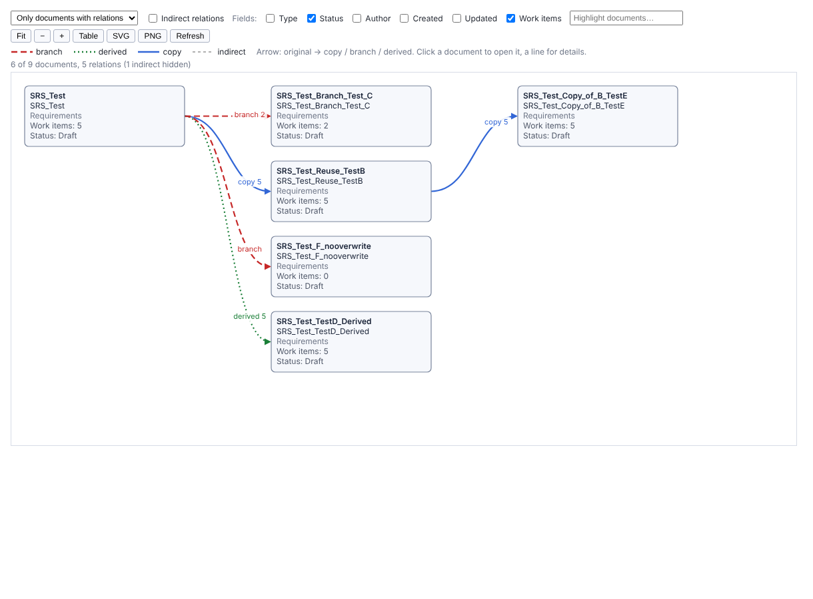

# Polarion Branches Widget

A Siemens Polarion **LiveReport widget** that shows the documents of a project and how they relate to
each other — which documents are **branches** of which, and which are **copies** (reuse) of which.

> Status: **v0.1.0 — first implementation, to be validated on Polarion 2512.** Spike complete
> (`tests/v0.1.x/spike-tests.md`). Install: [`docs/install.md`](docs/install.md). Requirements: [`SPECIFICATION.md`](SPECIFICATION.md).



## Why

Polarion tracks branching and copying, but there is no single at-a-glance view of the document family
tree of a project. This widget aims to provide one, embeddable in any LiveReport page.

## How it is expected to work

Relations are **deduced from work item links** between documents' work items (plus document-level
"branched from" metadata where available):

1. Collect the documents in scope (project, space, or a selection).
2. Read the links between their work items using configurable link roles.
3. Aggregate item-level links into document-to-document relations (e.g. "≥ N items of B are linked to A").
4. Classify each relation (copy / branch / derived) and render a graph or tree.

## Build and test

```
python3 tools/build-widget.py   # inline the JS, check with Velocity 1.4, write widget/dist/docBranches.zip
tools/test-widget.sh            # build + render with Velocity 1.4 on mock data + Chromium screenshots
tools/vcheck.sh                 # parse every .vm file with Velocity 1.4
```

Requires Java (for Velocity 1.4), Python 3 and Node with Playwright (for the browser check).

## Continuous integration and releases

- **CI** (`.github/workflows/ci.yml`): on every push and pull request, runs `tools/test-widget.sh`, checks that the
  committed `widget/dist` matches the sources, and keeps the zip and screenshots as a build artifact.
- **Release** (`.github/workflows/release.yml`): versions are **N.N.N** (semantic versioning: major = incompatible
  change of parameters or behaviour, minor = new feature, patch = fix). To release:
  1. update `VERSION` (e.g. `0.2.0`) in the change that goes to `main`;
  2. on GitHub, **Releases → Draft a new release**, tag `v0.2.0` on `main`, **Publish**;
  3. the workflow tests the widget, stamps the version and attaches **`docBranches-0.2.0.zip`** to the release.
     Upload that zip in Polarion (see [`docs/install.md`](docs/install.md)).

  A tag that is not `N.N.N`/`vN.N.N` fails the workflow. The workflow can also be re-run by hand
  (*Actions → Release → Run workflow*) with an existing tag.

## Repository contents

| File | Purpose |
|---|---|
| `SPECIFICATION.md` | Requirements, decisions and open checks |
| `widget/src/` | Widget sources: `render.vm`, `parameters.vm`, `branches-graph.js` (inlined at build) |
| `widget/dist/docBranches.zip` | Upload package (generated, committed for convenience) |
| `docs/install.md` | Install and configuration guide |
| `tools/build-widget.py`, `tools/test-widget.sh`, `tools/vtest/` | Build, Velocity 1.4 harness with mock Polarion objects, browser check |
| `tests/v0.1.x/` | Spike of release 0.1.x, kept for reference: test plan with the findings, diagnostic widget (see its [README](tests/v0.1.x/README.md)) |
| `CLAUDE.md` | Instructions for Claude Code working in this repo |
| `Polarion_Development_Guide.md` | Polarion development best practices (baseline: Polarion 2512) |

## References

- Polarion extensions portal: <https://extensions.polarion.com> (e.g. Diff-Tool #476, Graphical and Tabular Impact Analysis Widget #354)
- Siemens Polarion blog (branching, compare/merge, bulk branching): <https://blogs.sw.siemens.com/polarion/>
- Extra Widgets (Apache-2.0, archived): <https://github.com/Polarion/com.polarion.alm.extensions.widgets>
- SBB Polarion extensions (Java/Maven packaging reference): <https://github.com/SchweizerischeBundesbahnen>
- Polarion SDK and Widget SDK are shipped with the installation at `<host>/polarion/sdk/`.
