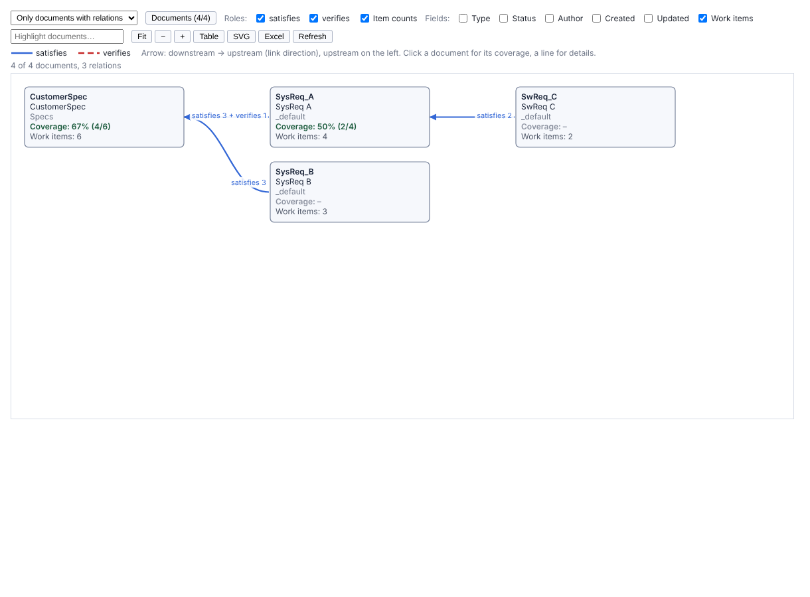

# Polarion document widgets

Siemens Polarion **LiveReport widgets** that show the LiveDocs of a project as a graph and the relations
between them, deduced from work item links. They share one client core, one build and one test setup.

| Widget | What it shows | Status | Docs |
|---|---|---|---|
| **docBranches** — Document Branches and Copies | Which documents are **branches**, **copies** (reuse) or **derived** from which | **0.3.0** released, validated on Polarion 2512 | [install](docs/docBranches/install.md) · [specification](widgets/docBranches/SPECIFICATION.md) |
| **docCoverage** — Document Coverage | For selected documents and 1–5 link roles, which document covers which: link counts, coverage % and uncovered items | **0.1.0** released, validated on Polarion 2512 | [install](docs/docCoverage/install.md) · [specification](widgets/docCoverage/SPECIFICATION.md) · [spike](tests/docCoverage-v0.1.x/spike-tests.md) |

Download the packages from the [releases](../../releases) (`docBranches-N.N.N.zip`, `docCoverage-N.N.N.zip`). Still
open for both widgets: behaviour for viewers who cannot read some documents (see each specification).




## Common features

- Interactive SVG graph (layered layout, zoom, highlight, tooltips, details with the linked work items).
- Table view, SVG download, Excel workbook download (CSV fallback).
- Static graph + table in PDF export and print (no JavaScript).
- Link roles, documents and excluded work item types chosen with Polarion selectors in the widget parameters (no typing).
- Viewer toggles (relation kinds or roles, item counts, extra document fields), defaults set as widget parameters.
- Velocity 1.4-safe templates, SQL scoped to one project, `isUnresolvable()` guard on every referenced object.

## Architecture

How the widgets work (server-side Velocity, page model, shared client core, static PDF view, tests) and where to
change what: [docs/ARCHITECTURE.md](docs/ARCHITECTURE.md).

## Build and test

```
python3 tools/build-widget.py                 # all widgets: inline shared code, check with Velocity 1.4, write the zips
python3 tools/build-widget.py --widget docBranches
tools/test-widget.sh [widget|all] [outDir]    # build + Velocity 1.4 render on mock data + Chromium checks
tools/vcheck.sh                               # parse every .vm file with Velocity 1.4
```

Requires Java (for Velocity 1.4), Python 3 and Node with Playwright (for the browser check).

## Continuous integration and releases

- **CI** (`.github/workflows/ci.yml`): on every push and pull request, builds and tests every widget, checks that the
  committed `widgets/*/dist` match the sources, and keeps the zips and screenshots as a build artifact.
- **Release** (`.github/workflows/release.yml`): each widget has its own version in `widgets/<widget>/VERSION`
  (**N.N.N**, semantic versioning: major = incompatible change of parameters or behaviour, minor = new feature,
  patch = fix). To release a widget:
  1. update `widgets/<widget>/VERSION` (e.g. `0.3.1`) in the change that goes to `main`;
  2. on GitHub, **Releases → Draft a new release**, in *Choose a tag* type the new tag **`<widget>-vN.N.N`**
     (e.g. `docBranches-v0.3.1`), pick *Create new tag on publish*, target `main`, **Publish**;
  3. the workflow tests that widget, stamps the version and attaches **`<widget>-N.N.N.zip`** to the release.
     Upload that zip in Polarion (see the widget's install guide).

  One release = one widget: to release both widgets, publish two releases, one per tag.

  A tag that is not `<widget>-vN.N.N` fails the workflow. The workflow can also be re-run by hand
  (*Actions → Release → Run workflow*) with an existing tag. Releases up to `v0.2.0` (tags `vN.N.N`) are docBranches
  releases made before the repository held several widgets.

## Repository contents

| Path | Purpose |
|---|---|
| `widgets/<widget>/src/` | Widget sources: `render.vm` (markers `## BW_SHARED <file>` and `## BW_INLINE_JS`), `parameters.vm`, `graph.js`, … |
| `widgets/<widget>/dist/` | Generated by the build: widget folder and upload zip (committed for convenience) |
| `widgets/<widget>/VERSION`, `SPECIFICATION.md` | Version, requirements, decisions and open checks of the widget |
| `shared/js/core.js` | Client core: layout, SVG drawing, toolbar parts, tooltip, zoom, table, SVG/Excel/CSV export |
| `shared/vm/` | Velocity snippets inlined at build: CSS, common parameters, lists/project/`bwKey`, document collection |
| `shared/resources/` | Third-party library for the Excel export: `xlsx.js` = `dist/xlsx.bundle.js` of [xlsx-js-style](https://github.com/gitbrent/xlsx-js-style) 1.2.0 (Apache-2.0, `LICENSE` next to it) |
| `docs/ARCHITECTURE.md` | Architecture of the widgets and how to extend them |
| `docs/<widget>/` | Install and configuration guide, previews |
| `tools/build-widget.py`, `tools/test-widget.sh`, `tools/vcheck.sh` | Build, tests, Velocity 1.4 parse check |
| `tools/vtest/<widget>/` | Velocity 1.4 harness with mock Polarion objects (`WidgetHarness.java`) and browser check (`browser-check.js`) |
| `tests/v0.1.x/` | Spike of docBranches 0.1.x, kept for reference: test plan with the findings, diagnostic widget (see its [README](tests/v0.1.x/README.md)) |
| `tests/docCoverage-v0.1.x/` | Spike of docCoverage 0.1.x: test plan C1–C4 and diagnostic widget `cvSpike` (see its [README](tests/docCoverage-v0.1.x/README.md)) |
| `CLAUDE.md` | Instructions for Claude Code working in this repo |
| `Polarion_Development_Guide.md` | Polarion development best practices (baseline: Polarion 2512) |

## References

- Polarion extensions portal: <https://extensions.polarion.com> (e.g. Diff-Tool #476, Graphical and Tabular Impact Analysis Widget #354)
- Siemens Polarion blog (branching, compare/merge, bulk branching): <https://blogs.sw.siemens.com/polarion/>
- Extra Widgets (Apache-2.0, archived): <https://github.com/Polarion/com.polarion.alm.extensions.widgets>
- SBB Polarion extensions (Java/Maven packaging reference): <https://github.com/SchweizerischeBundesbahnen>
- Polarion SDK and Widget SDK are shipped with the installation at `<host>/polarion/sdk/`.
