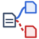

# User manual — Document Branches and Copies, Document Coverage

This manual is for Polarion users who want to show these widgets on a LiveReport page.

| Widget | Answers the question |
|---|---|
|  **Document Branches and Copies** | Which LiveDocs of the project are copies, branches or derived documents of which? |
|  **Document Coverage** | For the documents I choose and the link roles I choose (e.g. *satisfies*), which document covers which, how much (%), and which items are not covered? |

Both widgets work on the documents of the **current project**, or of the projects chosen in the *Projects* parameter.
The projects analysed are shown at the top of the widget. Both widgets look the same and have the same toolbar.

---

## 1. Getting the widgets into Polarion (deployment)

Before anyone can use a widget, it has to be uploaded to Polarion once. This needs administration rights.
**If you are not a project or platform administrator, ask your project administrator or the Polarion platform
team to deploy the widgets**, and give them this section.

For administrators:
1. Download the packages from the [releases page](../../../releases):
   - `docBranches-N.N.N.zip` for Document Branches and Copies;
   - `docCoverage-N.N.N.zip` for Document Coverage.
2. In Polarion, open **Administration → Documents and Pages → Velocity Widgets** and click **Upload**. Upload each
   zip as it is; do not unzip it. Then choose where the widget is available:
   - in **one project**, by uploading from that project's administration (good for a first try);
   - in **every project**, by uploading at **Repository** level.
3. To install a new version later, upload the new zip in the same place. It replaces the previous version, and the
   pages that use the widget keep working.

Technical details for administrators are in the install guides: [docBranches](docBranches/install.md),
[docCoverage](docCoverage/install.md).

## 2. Adding a widget to a page

Add the widget to a **LiveReport** page like any other Polarion widget. Open the page in edit mode, find
**Document Branches and Copies** or **Document Coverage** in the widget list (category *Work Items* / *Traceability*),
add it, set its parameters (see below), click **Apply** and save the page. You can put both widgets on the same page.

## 3. What you can set, and where

There are two places to change what the widgets show:

- **Widget parameters**, set by the page editor in edit mode. They decide **what is analysed** (documents, link
  roles, types) and **what every viewer sees first** (the defaults).
- **Toolbar**, used live by any viewer. It changes the view **for that viewer only** and does not modify the page.
  Reloading the page goes back to the defaults.

Settings available in both places are marked "Live: yes" in the tables below.

---

## 4.  Document Branches and Copies

### What it shows

One box per LiveDoc and one line per related pair of documents. The arrow goes from the **original** document to the
document made from it:

| Line | Meaning | How it is found |
|---|---|---|
| **copy** (blue, solid) | The document reuses or copies the original | Work items linked with a *copy* link role (default `duplicates`) |
| **branch** (red, dashed) | The document is a branch of the original | The document's *branched from* information, plus work items linked with a *branch* role (default `branched_from`) |
| **derived** (green, dotted) | The document was derived from the original | The document's *derived from* information, plus work items linked with a *derived* role (default `derived_from`) |
| **indirect** (grey, dashed) | The relation is only inherited through an intermediate copy, e.g. a copy of a copy | Hidden by default |

The number on a line is the number of work items linked between the two documents.

### Parameters

| Parameter | Default | What it does | Live |
|---|---|---|---|
| Projects | none = current project | Projects to analyse (choose in the list, several allowed). Relations between documents of two chosen projects are shown, and each document box shows its project | — |
| Copy link roles | `duplicates` | Link roles that mean "copy" (choose in the list, several allowed) | — |
| Branch link roles | `branched_from` | Link roles that mean "branch" | — |
| Derived link roles | `derived_from` | Link roles that mean "derived" | — |
| Work item types not counted | Heading | Work items of these types are ignored. Choose none to count all types | — |
| Spaces to include | empty = all | Limit the analysis to some spaces, comma separated, e.g. `Requirements, Design` | — |
| Minimum linked work items for a relation | 1 | Hide weak relations with fewer linked items. Relations confirmed by document information are always shown | — |
| Documents shown by default | Only documents with relations | Or *All documents* | yes |
| Indirect relations by default | Hidden | Or *Shown* | yes |
| Relation kinds shown by default | all | Copies, Branches, Derived | yes |
| Linked item counts on the lines by default | Shown | Or *Hidden*: the lines show only the kind | yes |
| Extra document fields shown by default | none | Type, status, created, updated, work item count, shown in the boxes | yes |
| Graph height in pixels | 600 | Height of the graph area | — |

---

## 5.  Document Coverage

### What it shows

Typical use: a **customer specification** whose requirements are *satisfied* by requirements in one or more
system or software specifications.

- **Upstream** document: the document whose items are the *targets* of the links, e.g. the customer specification.
  Upstream documents are drawn on the **left**.
- **Downstream** document: the document whose items *hold* the links, e.g. the system requirements that satisfy the
  customer requirements. The arrow goes from the downstream document to the upstream one, in the direction of the
  link.
- Each line shows the **link roles and the number of links**, e.g. `satisfies 42 + verifies 3`.
- Each upstream document shows its **coverage**: the share of its work items that have at least one link from a shown
  downstream document, e.g. `Coverage: 83% (5/6)`.
- Chains are supported. For example, a test specification can verify a system specification that satisfies a
  customer specification.

### Parameters

| Parameter | Default | What it does | Live |
|---|---|---|---|
| Projects | none = current project | Projects to analyse (choose in the list, several allowed). Links between documents of two chosen projects count, e.g. a system specification in another project that satisfies the customer specification | — |
| Documents of the current project | none = all documents | The LiveDocs to analyse. Select at least the upstream document and its downstream documents. The list shows the documents of the current project only (Polarion limitation): for the other projects, use the next parameter | Hide/show with the **Documents** button |
| Documents of other projects | empty = all documents of the other chosen projects | Type the documents of the other projects, comma separated, as `project/space/document`, e.g. `PROJ_B/Requirements/SysReq, PROJ_C/_default/SwReq`. `project/document` means the default space. When filled, only the listed documents of the other projects are analysed. The project must also be chosen in *Projects*. Wrong, unknown or unselected entries are reported in a warning | Hide/show with the **Documents** button |
| Collection context | Use | *Use*: when the page is opened in a **collection**, only the documents of the collection (and of its upstream collections) are analysed, each at the revision the collection pins. *Projects* and the document parameters are then not used. *Ignore*: always the current documents | — |
| Collection | none | Used only when the page is **not** opened in a collection: in the **PDF export** (Polarion's PDF export does not know the collection) or to tie a page outside the collection to it. Choose the same collection as the page | — |
| Link roles (1 to 5) | none, **must be set** | The link roles that count as coverage, e.g. `satisfies`, `verifies`. If more than 5 are selected, only the first 5 are used and a warning is shown | Each role can be hidden or shown |
| Work item types not counted | Heading | These types are not counted in the coverage, and links to them are ignored. Choose none to count all types | — |
| Spaces to include | empty = all | Limit the documents to some spaces, comma separated (the default space is `_default`) | — |
| Documents shown by default | Only documents with relations | Or *All selected documents* | yes |
| Link counts on the lines by default | Shown | Or *Hidden*: the lines show only the role names | yes |
| Extra document fields shown by default | none | Type, status, created, updated, work item count | yes |
| Graph height in pixels | 600 | Height of the graph area | — |

**In a collection** the scope line shows the collection, e.g. `Collection: Release 1 (with upstream: System baseline)`.
Documents, work items, links and coverage are those of the revision each document has in the collection, so the numbers
can differ from the current documents. A document added to the collection without a fixed revision is read as it is now
and is marked **(HEAD)**. Documents and work items open in the collection. For a PDF of a collection report, set the
*Collection* parameter, or print the page from the browser (the browser print keeps the collection).

When you hide a role or a document in the toolbar, the coverage is **recalculated**. For example, you can hide the
test specification to see the coverage by the system specifications only. Items that were covered only by hidden
lines then appear as uncovered.

---

## 6. Using the widgets (both)

### Toolbar

| Control | What it does |
|---|---|
| *Only documents with relations* / *All documents* | Show only the connected documents, or every analysed document (unconnected ones in a grid below) |
| **Documents (n/m)** (Coverage only) | Choose which of the analysed documents are shown |
| **Indirect relations** (Branches only) | Show the relations inherited through an intermediate copy |
| **Relations:** Copies / Branches / Derived (Branches), **Roles:** one per role (Coverage) | Show or hide each kind of line |
| **Item counts** | Show or hide the numbers on the lines |
| **Fields:** Type, Status, Created, Updated, Work items | Extra lines in the document boxes |
| **Highlight documents…** | Type part of a document name or title to highlight it |
| **Fit**, **−**, **+** | Fit the graph to the view, zoom out, zoom in |
| **Table** / **Graph** | Switch between the graph and a table of the same information |
| **SVG** | Download the graph as an SVG image |
| **Excel** | Download an Excel workbook with what is currently shown (see below) |
| **Refresh** | Reload the page and run the analysis again (e.g. after links were changed) |

### Mouse

- **Hover a line** for a summary (counts and coverage).
- **Click a line** for the details, including the linked work items (first 30, with links to open them).
- **Click a document**:
  - *Branches and Copies*: opens the document.
  - *Coverage*: shows its coverage and the list of **uncovered items**, with a link that opens the document.

### Traceability matrix (Coverage)

The details box of a document or a line has a **Traceability matrix (Excel)** button. It downloads the matrix of the
work items, built from what the graph shows (roles ticked in the toolbar, documents shown, excluded types left out):

| Column | Content |
|---|---|
| Work item | Id of a work item of the document (link to Polarion) |
| Title | Its title |
| Linked item | Id of a linked work item (link to Polarion); **uncovered** when an item of an upstream document has no link, **not linked** when the document is only downstream |
| Linked item title | Its title |
| Link | Role name for a link the item makes (e.g. *refines*), opposite name for a link pointing to it (e.g. *is refined by*) |
| Linked document | Document of the linked item (document matrix only) |

An item with several links is repeated on several lines. Items are sorted by id.

- **Document**: one sheet with the links of its items to all the shown documents, in both directions.
- **Line** (downstream → upstream): sheet *Upstream coverage* with every upstream item and its links from this
  downstream document (*uncovered* when none), and sheet *Downstream links* with every downstream item and its links
  to the upstream document (*not linked* when none).

In a collection, ids and titles are those of the collection revision. Very large pages are capped (20 000 links and
20 000 work items per page); the status line then says that the matrix is truncated.

### Excel export

The workbook follows the current toolbar choices, and every item and document has a link back to Polarion.

| Widget | Sheets |
|---|---|
| Branches and Copies | Relations, Documents, Linked items (up to 30 per document pair) |
| Coverage | Relations, Documents (with coverage and the collection revision), Uncovered items (up to 500 per document), Linked items (all links of the shown lines) |

If the browser blocks the Excel library, the button downloads the relations as a CSV file instead, and the status line
says so.

### PDF export and printing

When the page is exported to PDF or printed, the widgets show a static graph and tables. The toolbar does not apply
there; the PDF uses the **parameter defaults** of the widget.

## 7. Good to know

- The widgets analyse the **current project**, or the projects chosen in *Projects*. Links to documents of other
  projects are ignored. The scope line at the top says which projects are analysed.
- With several projects, every document shows its project (box, table, Excel), and links open the document or work
  item in its own project. Each extra project adds rendering time: a warning is shown above 5 projects.
- Document Coverage in a collection: Polarion's PDF export of the page has no collection, so it shows the current
  documents unless the *Collection* parameter is set (see section 5).
- Link roles and work item types are chosen from the current project's configuration. Other projects must use the
  same role and type ids for their links and items to be found.
- Links between items of the same document and links to items you cannot read are ignored.
- The analysis runs when the page opens. Use **Refresh** after changing links.
- The version of a widget is shown in the PDF header. Give it when reporting a problem.
- If a widget shows "select at least one link role", edit its parameters and choose the link roles.
