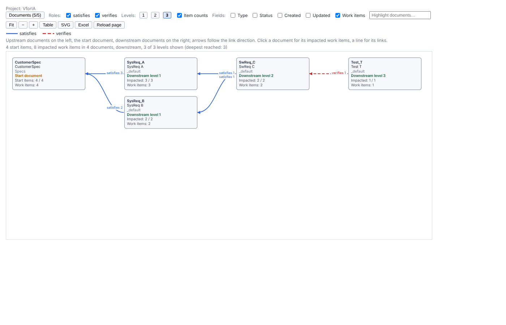
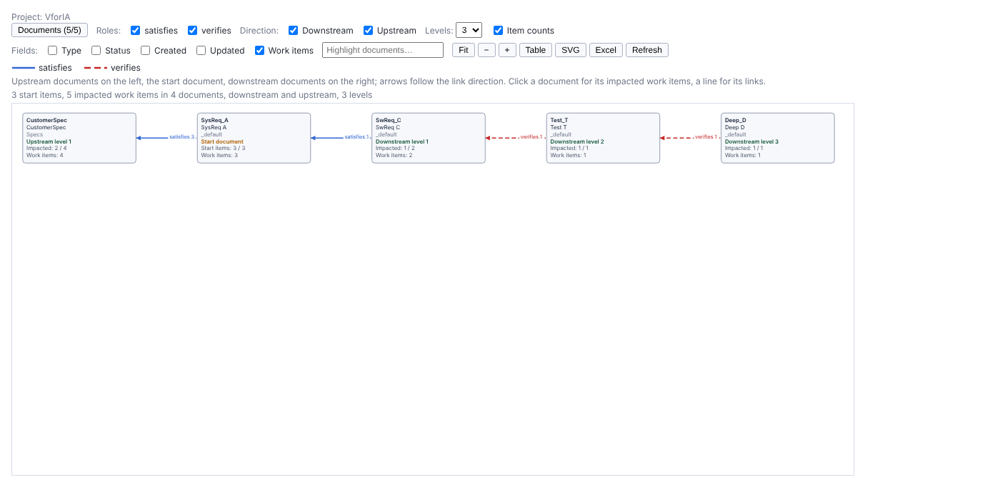
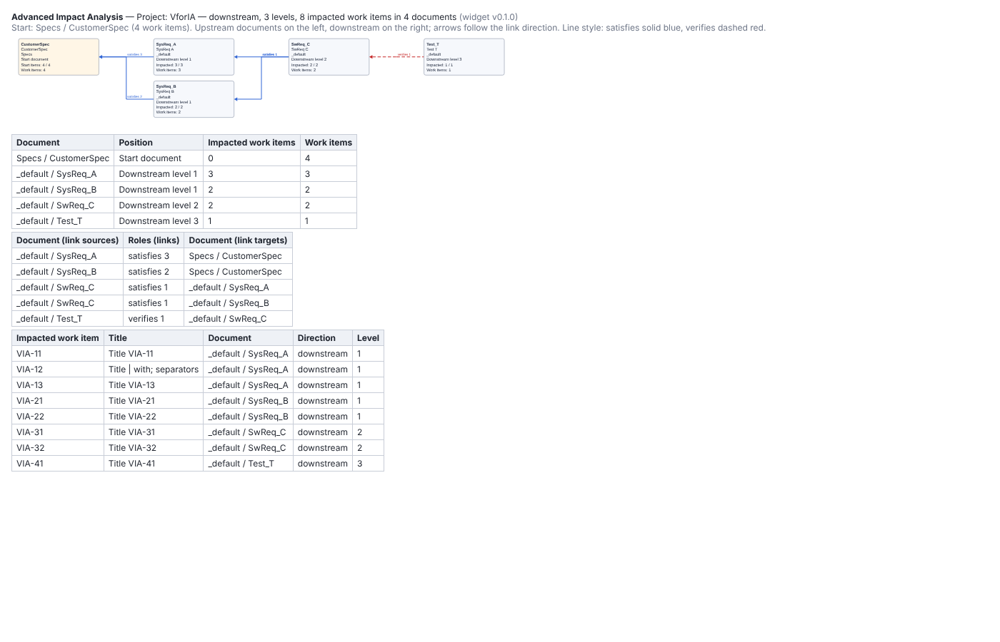

# Advanced Impact Analysis — install and configuration

Widget id `advImpact`, version in `widgets/advImpact/VERSION` (N.N.N; shown in the PDF header and as `data-version`).
Target: Polarion 2512 (keep compatible with 2606). Requirements: [`widgets/advImpact/SPECIFICATION.md`](../../widgets/advImpact/SPECIFICATION.md).
Method verified by the spike on 2512: [`tests/advImpact-v0.1.x/spike-tests.md`](../../tests/advImpact-v0.1.x/spike-tests.md).

## Install

1. Download the package: from a GitHub **release** tagged `advImpact-vN.N.N`, the asset `advImpact-N.N.N.zip`
   (recommended), or `widgets/advImpact/dist/advImpact.zip` from the repository (development build). The folder inside
   is always `advImpact/`, so a new version overwrites the previous one on upload.
2. **Administration → Documents and Pages → Velocity Widgets → Upload**, in a project or in the repository (global).
3. On a LiveReport page of a project, in edit mode, add **Advanced Impact Analysis** (category *Work Items* /
   *Traceability*), set the parameters below, **Apply** and save the page.

## Parameters

| Parameter | Default | Meaning |
|---|---|---|
| Start document | none | The LiveDoc the analysis starts from (document selector, current project) |
| Start items: work item query | empty = all items | Lucene query that selects some work items of the start document, e.g. `type:stakeholderrequirement AND status:in_analysis`. The widget restricts it to the start document |
| Link roles (1 to 5) | none | The link roles followed, e.g. `satisfies`, `verifies`. More than 5: the first 5 are used |
| Direction | Downstream | **Downstream**: items that link to the start items, then the items that link to those, and so on. **Upstream**: the items the start items link to, and so on. **Both**: the two analyses combined (a path never changes direction) |
| Levels of analysis (1 to 7) | 3 | Number of link steps followed. Viewers can show fewer levels, not more |
| Work item types not followed | Heading | Work items of these types are neither start items nor followed |
| Link counts on the lines by default | Shown | Or *Hidden*. Viewers can toggle it |
| Extra document fields shown by default | none | Type, status, created, updated, work item count. Viewers can toggle them |
| Graph height in pixels | 600 | Height of the scrollable graph area |
| Collection context | Use | Use: on a page opened in a collection, the work items and links of the collection documents and of its upstream collections, at their collection revisions (the start document must be in the collection). Ignore: current work items |
| Collection | none | `@collection` selector, used when the page has no collection context: Polarion PDF export, or a page outside the collection |

## How the analysis works

- A link is stored on its **source** work item and points to its **target** (verified on 2512). Level 1 = the items
  linked to the start items with a selected role (downstream: link sources; upstream: link targets); level 2 = the items
  linked to level 1 items, and so on. Each work item is counted once, at its lowest level; links back to items already
  reached are not followed (cycles, inherited links of copies of copies).
- A document is placed at the level of its lowest impacted item: upstream levels on the left, the start document, then
  downstream levels on the right. A line between two documents counts the links along the analysis paths.
- Safety limits: an analysis direction stops after a level with more than 5 000 new work items, or when more than
  20 000 work items are reached; a warning is shown. The page holds at most 40 000 links.
- **In a collection** (0.3.0): the items of the collection documents and the links of the selected roles between them
  are read once from the collection tables, at the revisions the collection pins (queries verified by the docCoverage
  spike); the levels are then followed on them. The start query runs on the current items of the start document, and
  the matching items are taken at the collection revision. Documents without a pinned revision are marked (HEAD).

## Using the widget

- **Toolbar**: **Start items** picker (search on id or title, type filter; narrows the start items of the page and
  recomputes the analysis; leave the query empty to pick from the whole document), **Documents** picker (hide documents from the graph; the analysis still goes through them), roles,
  direction (when the parameter is *Both*), **Levels** buttons (1 to the parameter; the status line shows the deepest
  level reached), item counts, extra fields, highlight, Fit / zoom, Table / Graph, SVG, Excel, Reload page (reloads the
  whole page: Polarion cannot re-run one widget alone). Changing roles, direction or levels recomputes the analysis in the browser.
- **Click a document** for its impacted work items, each with its direction, level and the item it was reached from.
  **Traceability matrix (Excel)** in the details: each reached work item of the document with its links (role name for
  outgoing links, opposite name for incoming ones), the linked document and the linked item's level.
- **Hover / click a line** for the links between the two documents.
- **Excel**: sheets Relations, Documents (position, level, impacted items, collection revision), Impacted items (with "reached from"),
  Impact paths (one path from a start item to each impacted item, with the links along it), Start items. CSV fallback when the Excel
  library is not loaded.
- **PDF export / print**: static graph, documents table, relations table and the first 200 impacted work items (no JavaScript).

## Known limitations (0.3.0)

- Current project only: links to work items of other projects are not followed (later version, SPEC F15); in a
  collection, documents of other projects are not reached either.
- Collection context (0.3.0) not yet checked on 2512 (SPEC §8 lists the checks). In a collection the start query is
  evaluated on the current items, not on the collection revision.
- The **Start items** picker narrows the start items of the page (whole document or query); it cannot add other items
  without changing the query. The PDF export uses all start items.
- Work items outside a LiveDoc are followed but not drawn (they have no document).
- Permission filtering for viewers who cannot read some documents has not been checked (same open check as the other widgets).
